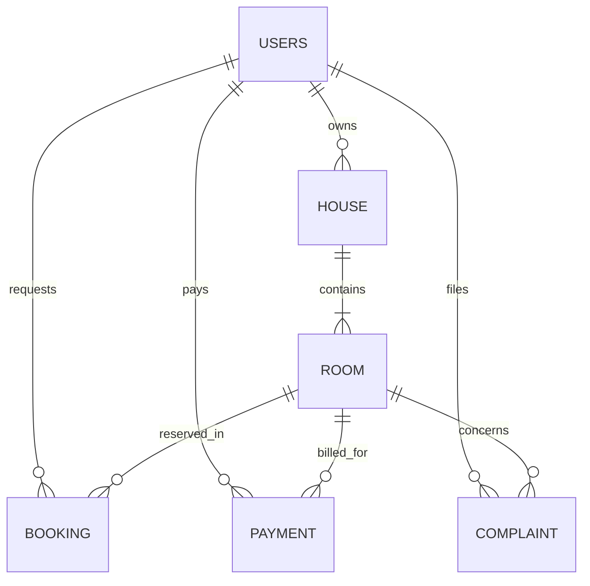

# KosMate 🏠

> Modern Boarding House (*Kost*) Management Mobile Application built with Flutter and Supabase.

KosMate is a comprehensive, multi-tenant boarding house management platform designed for the Indonesian rental ecosystem. It bridges the gap between **Boarding House Owners**, **Tenants**, and **System Administrators** with real-time operations, transparent billing, integrated digital payments, and maintenance ticket tracking.

---

## 🚀 Key Features by Role

### 🏢 Boarding House Owner

- **Multi-House Management**: Single owners can manage multiple boarding houses with distinct addresses, rules, and facilities.
- **House-First Room Creation**: Guided creation hierarchy ensuring rooms are always organized under specific boarding houses.
- **Unified Management Hub** (3-Segment Operations):
  - **Rooms & Renters**: Per-room summary cards displaying active tenant, rent status, and open maintenance alerts.
  - **Invoices & Payments**: Monthly billing overview, collection KPI metrics (Collected, Pending, Overdue), and manual payment verification.
  - **Complaints & Maintenance**: Inline ticket management with status transitions (*In Progress*, *Resolved*, *Rejected*) and resolution notes.
- **Occupancy Dashboard**: Live room statistics (*Total*, *Occupied*, *Available*).

### 👤 Tenant

- **Room Discovery & Booking**: Explore available rooms with photo galleries, facilities, and rent prices; submit move-in booking requests.
- **Digital Payments (Midtrans Gateway)**: Pay monthly dues seamlessly via GoPay and QRIS with automated transaction verification.
- **Manual Transfer Receipt Upload**: Alternative payment method with photo/URL receipt submission for owner approval.
- **Maintenance & Complaints**: File maintenance tickets with category, priority, description, and photo attachments.

### 🛡️ System Administrator

- **Admin Dashboard**: System-wide statistics for total registered users, houses, and recent platform activities.
- **User Management**: Complete CRUD over users with role assignment (`admin`, `owner`, `tenant`).
- **Boarding Houses Directory**: Platform-wide catalog of all boarding houses and owners.

### 🧪 Diagnostic & Developer Tools

- **CRUD Testing Hub**: Dedicated test screen accessible from Profile to test end-to-end frontend-to-database connectivity across all 6 schema tables (*Users*, *Houses*, *Rooms*, *Bookings*, *Payments*, *Complaints*).

---

## 🛠️ Technology Stack

| Layer | Technology |
| --- | --- |
| **Frontend Framework** | [Flutter](https://flutter.dev/) (SDK ^3.13.5, Dart ^3.0) |
| **UI Design System** | Material 3 + Custom KosMate Component Library (`kosmate_components.dart`) |
| **Backend & Database** | [Supabase](https://supabase.com/) (PostgreSQL, Row Level Security, Auth, Storage) |
| **Architecture** | Service-Locator Pattern (`sl`), Model-Service-Screen separation |
| **Payment Gateway** | [Midtrans](https://midtrans.com/) Core API (GoPay & QRIS e-wallets) |
| **State Management** | Ephemeral `StatefulWidget` / `setState` with centralized service singletons |

---

## 📁 Project Structure

``` tree
lib/
├── core/
│   ├── constants/            # Supabase URLs, table names, storage buckets
│   ├── di/                   # Service Locator (sl singleton registry)
│   ├── errors/               # Custom application exception classes
│   ├── theme/                # Global color palette, typography & ThemeData
│   ├── utils/                # Date/currency formatters, JSON & Supabase helpers
│   └── widgets/              # Shared UI components (StatusChip, SearchBar, Button, AppBar)
├── models/                   # Immutable data models with JSON serialization
│   ├── booking_model.dart
│   ├── complaint_model.dart
│   ├── house_model.dart
│   ├── payment_model.dart
│   ├── room_model.dart
│   └── user_model.dart
├── screens/
│   ├── admin/                # Administrator screens (Dashboard, Users, Houses)
│   ├── auth/                 # Authentication screens (Login, Register, Terms)
│   ├── houses/               # Shared house detail & creation forms
│   ├── owner/                # Owner screens (Home Dashboard, Rooms, Management Hub)
│   ├── tenant/               # Tenant screens (Home, Room Explorer, Payments)
│   ├── shared/               # Shared screens (AuthGate, Profile, Splash, CRUD Test Hub)
│   └── shared_crud/          # Standalone CRUD form screens (Booking, Payment, Complaint)
└── services/                 # Business logic and Supabase client interaction
    ├── auth_service.dart
    ├── booking_service.dart
    ├── complaint_service.dart
    ├── house_service.dart
    ├── midtrans_service.dart
    ├── payment_service.dart
    ├── room_service.dart
    ├── storage_service.dart
    └── user_service.dart
```

---

## 📊 Database Schema & Entities



| Table | Description |
| --- | --- |
| `users` | User accounts with roles (`admin`, `owner`, `tenant`), phone, avatar |
| `houses` | Boarding house metadata (name, address, rules, facilities, owner reference) |
| `rooms` | Individual rooms with room number, floor/type, price, status (`available`, `occupied`, `maintenance`) |
| `bookings` | Rental booking requests with move-in dates and approval status |
| `payments` | Monthly rent invoices, due dates, paid dates, and Midtrans transaction IDs |
| `complaints` | Maintenance tickets with category, priority, status, and owner responses |

---

## ⚙️ Getting Started

### Prerequisites

- [Flutter SDK](https://docs.flutter.dev/get-started/install) (`^3.13.5` or later)
- Android Studio / VS Code with Flutter extension
- An active [Supabase](https://supabase.com/) project with the database schema applied
- (Optional) A [Midtrans Sandbox](https://dashboard.sandbox.midtrans.com/) account for payment testing

### Installation

1. **Clone the repository:**

   ```bash
   git clone https://github.com/rasyaakbar-dev/kosmate.git
   cd kosmate
   ```

2. **Install Flutter dependencies:**

   ```bash
   flutter pub get
   ```

3. **Configure Environment Constants:**
   Update your Supabase credentials in `lib/core/constants/supabase_constants.dart`:

   ```dart
   static const String supabaseUrl = 'https://YOUR_SUPABASE_PROJECT.supabase.co';
   static const String supabaseAnonKey = 'YOUR_SUPABASE_ANON_KEY';
   ```

4. **Run Code Analysis:**

   ```bash
   flutter analyze
   ```

5. **Run the Application:**

   ```bash
   flutter run
   ```

---

## 💳 Payment Flow (Midtrans)

1. Owner/System issues a payment invoice for a room.
2. Tenant opens the **Payment** tab and selects **"Pay with GoPay / QRIS"**.
3. KosMate backend invokes Midtrans Core API to generate a dynamic QRIS / GoPay deeplink.
4. Tenant scans the QR code or pays via GoPay.
5. On settlement, invoice status transitions to `Paid` automatically.

---

## 📄 License

This project is licensed under the GPLv3 License - see the LICENSE file for details.
